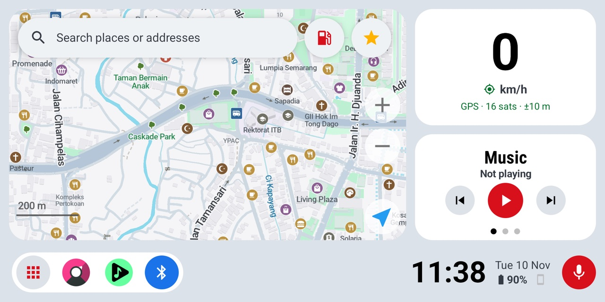
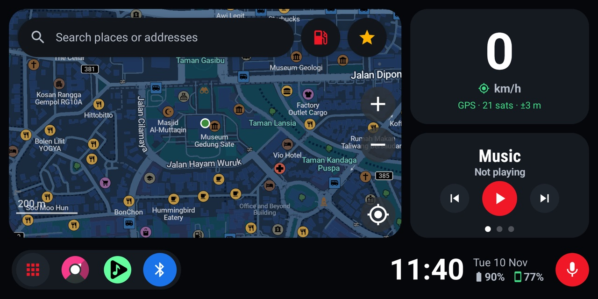
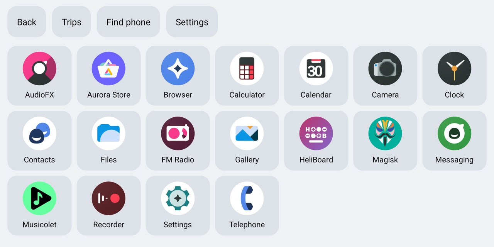
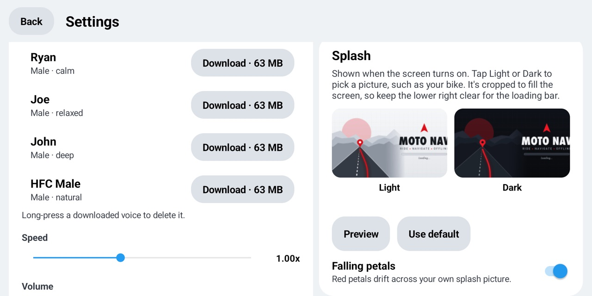

<h1 align="center">Moto Nav</h1>

<p align="center">An offline motorcycle head unit for Android, built on <a href="https://organicmaps.app">Organic Maps</a>.</p>

Moto Nav turns a spare Android phone into a dashboard for your motorcycle. It runs as the home screen (launcher) and is built for landscape mounts, gloves and quick glances while riding. It needs no Google services and no account, and maps, routing, voice guidance and voice commands all work offline.

<p align="center">
  
  
</p>
<p align="center">
  
  
  
</p>

## Features

**Navigation**
- Offline maps and turn-by-turn routing from Organic Maps (OpenStreetMap data)
- Built-in offline voice guidance (Piper voices) that starts by itself when navigation starts
- Thicker, high-contrast route line, auto-recenter and a driving layout
- Saved places: save a destination or your location with a nickname, then say "take me home" or "navigate to office"
- Offline maps update automatically over Wi-Fi when you're not riding

**Voice commands**
- Offline English speech recognition (Whisper Tiny or Base), with no cloud service involved
- Works from the mic button or an intercom double tap, using the helmet microphone over Bluetooth
- Examples: "navigate to Garut", "find a gas station", "next song", "pause music", "open Musicolet"

**Dashboard**
- Bottom bar with clock, date, phone battery and an app dock
- Side panel that switches between music, weather and notifications
- Light, dark or automatic theme that follows the light sensor
- Splash animation on start and every time the screen turns on, with your own artwork if you like (see [Custom splash](#custom-splash))
- Heat warning when the battery or CPU gets too hot
- Trip history

**Watch link (Chronos)**
- Moto Nav acts as a Chronos-compatible watch, so your main phone's notifications, calls (with a reject button), weather and media show up on the head unit
- Find your phone from the head unit

**Ignition automation (root)**
- Charger plugged in: the screen wakes, location turns on and airplane mode turns off
- Charger unplugged: the screen turns off, then location turns off and airplane mode turns on after 15 seconds
- Powers off after 48 hours unplugged
- When the screen turns off, Moto Nav comes back to the front, so the map is always the first thing you see

**In-app updates**
- Settings → App update checks the latest GitHub release, then downloads and installs it
- On Wi-Fi it also checks every few hours and shows a banner when a new version is out

## Free, not for sale

Moto Nav is free. Please don't sell it, bundle it with phones or head units you sell, or charge people to install it. If you paid for Moto Nav, you were overcharged: ask for a refund and get it here instead.

Official builds come only from this repository's [Releases](https://github.com/edgarjuvianno/moto-nav/releases) and are signed with the Moto Nav release key:

```
SHA-256: 07:BC:31:72:29:95:24:F9:AB:95:A2:24:51:C8:4B:A2:95:1D:41:FC:DE:7E:C3:A4:A8:78:BF:4D:0C:01:CE:8D
```

Only official builds receive in-app updates. If you see Moto Nav being sold, please [open an issue](https://github.com/edgarjuvianno/moto-nav/issues).

## Requirements

- An Android phone with a 64-bit ARM (arm64-v8a) processor
- Android 9 or newer is recommended. It was developed and tested on a Zenfone Max Pro M1 running LineageOS (Android 17).
- Root (Magisk) is optional. It's needed for ignition automation, returning to the map on screen off and silent updates. Without root those settings are hidden and everything else works.

## Install

1. Download `MotoNav-vX.Y.Z-arm64.apk` from [Releases](https://github.com/edgarjuvianno/moto-nav/releases/latest).
2. Open it on the phone and allow installing from that source.
3. Set Moto Nav as the default home app.
4. In **Settings**, download:
   - a voice for guidance
   - a Whisper model for voice commands (Base is recommended, about 161 MB)
   - the offline maps for your region

To update later, use **Settings → App update**. With root it installs silently; without root Android asks you to confirm.

## Custom splash

Show your own picture when the screen turns on, for example your bike:

1. Open **Settings → Splash**.
2. Tap **Light** or **Dark** and pick a photo. If you pick only one, it's used for both themes.
3. Tap **Preview** to check it, or **Use default** to go back to the Moto Nav splash.

Photos are cropped to fill the screen (2160 × 1080), and the loading bar runs across the lower right, so a picture with a calm lower-right area looks best. **Falling petals** adds drifting red petals on top. Your pictures stay on the phone and survive app updates.

## Building

Moto Nav builds like Organic Maps. Set up the toolchain with [docs/INSTALL.md](docs/INSTALL.md), then:

```bash
cd android
./gradlew -Parm64 -Punity -Pnjobs=8 assembleFdroidRelease
```

Release signing reads `android/app/secure.properties`, which is not in the repository:

```groovy
ext {
  spropStoreFile = '/path/to/your-release.jks'
  spropStorePassword = '...'
  spropKeyAlias = '...'
  spropKeyPassword = '...'
}
```

Without that file, release builds are signed with the debug key and can't update an installed release.

Useful Gradle properties:
- `-PmotoVersion=1.3.0` sets the version shown in the app and compared during update checks. The default lives in `android/app/build.gradle`.
- `-PmotoUpdateApi=<url>` points the update check at a different release API, which is handy for testing.

### Publishing a release

1. Bump the default `motoVersion` in `android/app/build.gradle`.
2. Build the release APK and tag the commit `vX.Y.Z`.
3. Create a GitHub release for the tag and attach the APK as an asset whose name ends in `.apk`.

The in-app updater reads `releases/latest`, compares the tag with the installed version and verifies the asset's SHA-256 when GitHub provides it.

Moto Nav-specific code lives in `android/app/src/main/java/app/organicmaps/moto/`.

## Credits

- Built on [Organic Maps](https://organicmaps.app), which uses [OpenStreetMap](https://www.openstreetmap.org) data. Moto Nav is an independent fork and isn't affiliated with or endorsed by the Organic Maps project.
- Moto Nav is a community project for riders and isn't affiliated with, endorsed by or sponsored by any motorcycle manufacturer. All trademarks belong to their owners.
- Offline speech uses [sherpa-onnx](https://github.com/k2-fsa/sherpa-onnx), [Piper](https://github.com/rhasspy/piper) voices and [Whisper](https://github.com/openai/whisper) models.

## License

The source code is licensed under the Apache License 2.0, the same as Organic Maps. See [LICENSE](LICENSE) and [NOTICE](NOTICE).

The APK also bundles third-party components under their own licenses, including:
- [sherpa-onnx](https://github.com/k2-fsa/sherpa-onnx) and ONNX Runtime (Apache 2.0, MIT)
- [espeak-ng](https://github.com/espeak-ng/espeak-ng), used for voice guidance (GPL-3.0)

Because espeak-ng is GPL-3.0, the APK as a whole is distributed under the terms of the GPL-3.0, and its complete source is this repository.

Map data is © OpenStreetMap contributors and licensed separately; see [DATA_LICENSE.txt](DATA_LICENSE.txt). Voices and speech models downloaded in the app keep their own licenses.
