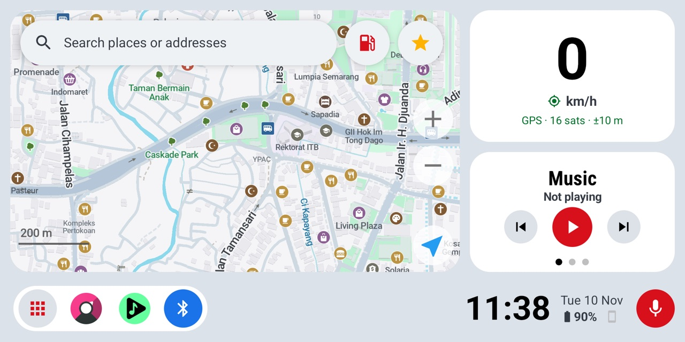
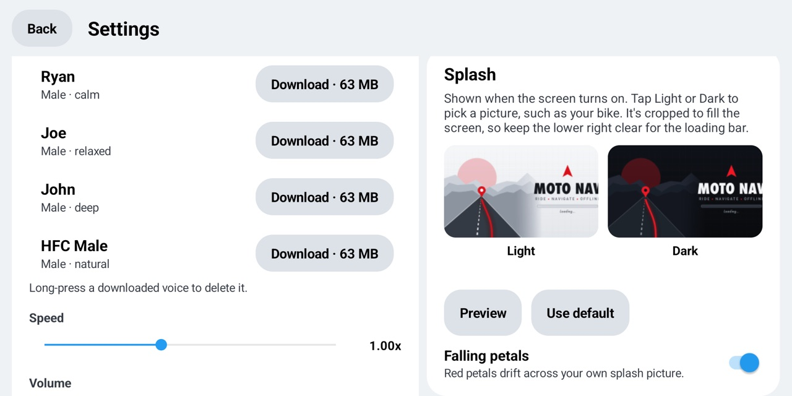

# Panduan pengguna Moto Nav

[English](USER_GUIDE.md)

Panduan ini membahas cara memasang Moto Nav di HP cadangan yang dipasang di motor, dan cara memakainya di jalan.

- [1. Yang dibutuhkan](#1-yang-dibutuhkan)
- [2. Install dan setup awal](#2-install-dan-setup-awal)
- [3. Layar utama](#3-layar-utama)
- [4. Navigasi](#4-navigasi)
- [5. Perintah suara](#5-perintah-suara)
- [6. Tempat tersimpan](#6-tempat-tersimpan)
- [7. Menghubungkan HP utama (Chronos)](#7-menghubungkan-hp-utama-chronos)
- [8. Tombol intercom untuk perintah suara (lanjutan)](#8-tombol-intercom-untuk-perintah-suara-lanjutan)
- [9. Dock dan menu aplikasi](#9-dock-dan-menu-aplikasi)
- [10. Riwayat perjalanan (Trips)](#10-riwayat-perjalanan-trips)
- [11. Settings](#11-settings)
- [12. Otomatis ikut kunci kontak (root)](#12-otomatis-ikut-kunci-kontak-root)
- [13. Update](#13-update)
- [14. Mengatasi masalah](#14-mengatasi-masalah)

Catatan: tampilan app memakai bahasa Inggris, jadi nama menu dan tombol di panduan ini ditulis apa adanya.

## 1. Yang dibutuhkan

- HP Android cadangan dengan prosesor 64-bit ARM. Disarankan Android 9 ke atas.
- Ruang kosong sekitar 3 GB untuk peta, suara panduan, dan model suara.
- Holder HP. Sebaiknya juga ada colokan USB dari motor, karena layar tetap menyala selama HP dicas.
- Opsional:
  - Intercom helm Bluetooth, untuk mendengar arah dan memberi perintah suara.
  - HP utama dengan app **Chronos**, untuk notifikasi, telepon, dan cuaca.
  - Root (Magisk), untuk fitur ikut kunci kontak.

## 2. Install dan setup awal

1. Di HP head unit, download `MotoNav-vX.Y.Z-arm64.apk` terbaru dari [Releases](https://github.com/edgarjuvianno/moto-nav/releases/latest), lalu buka. Izinkan instalasi dari browser atau file manager kalau diminta.
2. Tekan tombol Home, lalu pilih **Moto Nav** → **Always** supaya Moto Nav jadi layar utama. Kalau tidak muncul pilihan, buka **Pengaturan Android → Aplikasi → Aplikasi default → Aplikasi layar utama**.
3. Buka Moto Nav, lalu izinkan **Lokasi** dan **Notifikasi**.
4. Buka menu aplikasi (tombol kotak-kotak di kiri bawah) → **Settings**. Kartu **Setup** di paling atas menampilkan langkah yang belum beres, dan setiap langkah punya tombolnya sendiri:
   - **Home screen**, **Location**, dan **Microphone**: tekan **Set** atau **Allow**.
   - **Guidance voice**: tekan **Download** untuk lompat ke daftar suara. Download satu, misalnya Lessac atau Amy, lalu tekan **Use**.
   - **Voice commands model**: tekan **Download** untuk lompat ke Whisper. Disarankan **Base English** (sekitar 157 MB).
   - Tambahan opsional: kontrol musik, koneksi HP (Chronos), dan tombol intercom. Lihat bagian 7 dan 8.
5. Download peta offline wilayahmu: **Settings → Maps → Manage and update maps**.

Kalau masih ada langkah yang belum beres, Moto Nav akan mengingatkan lewat banner di layar utama.

Moto Nav berjalan sepenuhnya offline. Internet hanya dibutuhkan untuk download peta, suara, dan update, sebaiknya lewat Wi-Fi.

## 3. Layar utama

| Bagian | Fungsi |
| --- | --- |
| Kotak pencarian | Cari tempat dan alamat. Saat riding, mengetuknya langsung membuka input suara. |
| ⛽ Tombol bensin | Mencari SPBU terdekat. |
| ⭐ Tombol bintang | Daftar tempat tersimpan, dan menyimpan lokasi saat ini. |
| Kartu kecepatan | Kecepatan dan status GPS. Ketuk untuk membuka Trips. |
| Panel samping | Geser atau ketuk titik untuk pindah antara **Music**, **Weather**, dan **Notifications**. Kembali ke Music setelah 15 detik. |
| Tombol kotak-kotak (kiri bawah) | Menu aplikasi, Trips, Find phone, dan Settings. Terkunci saat riding. |
| Ikon dock | Aplikasi favorit. Tekan lama ikon untuk mengatur dock. |
| Jam, tanggal, baterai | Baterai HP head unit, dan baterai HP utama setelah Chronos tersambung. |
| 🎤 Tombol mic | Perintah suara. |

Moto Nav menganggap kamu sedang riding kalau kecepatan di atas 15 km/jam, dan berhenti setelah 20 detik di bawah 5 km/jam. Saat riding, menu aplikasi terkunci dan kotak pencarian beralih ke input suara.

**Layar mati dan nyala:** saat layar dimatikan, Moto Nav selalu kembali ke peta. Saat layar dinyalakan, animasi splash diputar.

**Kontrol musik:** supaya lagu yang diputar bisa tampil, Moto Nav butuh akses notifikasi. Aktifkan dari **Settings → Setup → Music controls**, atau ketuk judul lagu sekali.

## 4. Navigasi

1. Cari tempat, tekan tombol bensin atau bintang, atau pakai perintah suara. Hasil pencarian, detail tempat dan tempat tersimpan muncul di panel kiri, di samping peta.
2. Pilih hasil, lalu tekan **Start**. Preview rute menampilkan waktu, jarak dan titik singgah. Tekan **+ Add stop** untuk mampir di jalan, lalu tekan **Start**. Kalau sedang berkendara, navigasi langsung mulai tanpa preview.
3. Panduan suara langsung aktif tanpa perlu menekan apa-apa lagi.
4. Saat navigasi, tekan **+ Add stop** di kiri bawah, pilih tempat, cek rute barunya, lalu tekan **Continue**.

Rute selalu menghindari jalan tol dan jalan bebas hambatan.

## 5. Perintah suara

Tekan tombol 🎤 atau pakai intercom (lihat [bagian 8](#8-tombol-intercom-untuk-perintah-suara-lanjutan)), lalu bicara **dalam bahasa Inggris** setelah layar mendengarkan muncul.

| Ucapkan | Hasilnya |
| --- | --- |
| "navigate to Garut", "take me to Alun-Alun Bandung" | Mencari tempat itu dan menampilkan hasilnya |
| "find a gas station", "gas station", "fuel" | Mencari SPBU terdekat |
| "find a hospital", "pharmacy", "parking", "mosque", "ATM" | Mencari tempat sejenis di sekitar |
| "take me home", "go home" | Navigasi ke tempat tersimpan bernama **home** |
| "navigate to office" | Navigasi ke tempat tersimpan sesuai nama panggilannya |
| "next song", "previous song" | Ganti lagu |
| "pause music", "play music" | Jeda atau lanjutkan musik |
| "open Musicolet", "open apps" | Membuka aplikasi atau menu aplikasi |

Kalimat pendek dan jelas paling mudah dikenali. Kata seperti "nearest" atau "near me" boleh dipakai. Nama tempat lokal yang susah diucapkan dalam bahasa Inggris bisa salah dengar, jadi simpan tempat yang sering didatangi (lihat [bagian 6](#6-tempat-tersimpan)) dengan nama panggilan yang gampang diucapkan.

## 6. Tempat tersimpan

- **Simpan lokasi sekarang:** tekan ⭐ → **Save my current location**.
- **Simpan tempat:** ketuk tempat di peta atau di hasil pencarian, lalu tekan **☆ Save**.
- Beri nama panggilan pendek yang gampang diucapkan, misalnya **home**, **office**, atau **gym**. Lalu bilang "take me home" atau "navigate to office".
- **Ganti nama atau hapus:** buka **Settings → Saved places**. Ketuk untuk ganti nama, tekan lama untuk menghapus.

## 7. Menghubungkan HP utama (Chronos)

Moto Nav berperan sebagai smartwatch untuk HP utamamu, lewat app gratis **Chronos**.

Yang kamu dapat:
- Notifikasi dari HP utama, tampil sebagai banner 5 detik di atas, plus daftar di panel Notifications. Daftar itu disimpan sampai HP terputus.
- Banner **Incoming call** dengan nama penelepon. Ketuk untuk menutup. Banner hilang sendiri saat panggilan selesai.
- Cuaca, plus banner peringatan kalau akan hujan dalam satu jam.
- Persentase baterai HP utama, dengan peringatan saat 20% atau kurang.
- **Find phone**: buka menu aplikasi → **Find phone** untuk membuat HP utama berdering sampai kamu tekan **Found it**.

Cara setup:
1. Di HP head unit, nyalakan Bluetooth.
2. Di **Settings → Setup**, tekan **Allow** di sebelah **Phone link (Chronos)** untuk memberi izin Perangkat di sekitar.
3. Buka Moto Nav dan biarkan tetap tampil di layar.
4. Di HP utama, install **Chronos** dari Play Store dan tambahkan jam baru. Pilih perangkat dengan nama Bluetooth HP head unit.
5. Moto Nav akan menampilkan "Phone connected (Chronos)".

## 8. Tombol intercom untuk perintah suara (lanjutan)

Kebanyakan intercom punya fungsi asisten suara atau "redial". Moto Nav bisa mengubah **redial** jadi "mulai mendengarkan", jadi kamu bisa memberi perintah suara tanpa menyentuh layar.

1. Di **Settings → Voice input**, nyalakan **Intercom redial starts voice**. Izinkan **Log panggilan**, lalu pilih Moto Nav sebagai aplikasi pengalihan panggilan saat Android bertanya.
2. Pairing intercom dengan HP head unit.
3. Kembali ke peta sekali. Moto Nav akan menambahkan "Moto Nav voice" sebagai nomor terakhir yang dipanggil.
4. Di jalan, pakai fungsi **redial** di intercom. Di banyak intercom caranya ketuk dua kali tombol telepon; cek manual intercom-mu. Alih-alih menelepon, Moto Nav langsung mendengarkan.

Kalau mau redial kembali normal, matikan **Intercom redial starts voice**. Intercom akan menelepon nomor terakhir yang asli lagi.

## 9. Dock dan menu aplikasi

- **Buka menu aplikasi:** tekan tombol kotak-kotak di kiri bawah. Di bagian atas ada **Back**, **Trips**, **Find phone**, dan **Settings**.
- **Tambah aplikasi ke dock:** di menu aplikasi, tekan lama aplikasinya → **Add to dock**. Dock muat sampai 6 aplikasi.
- **Atur dock:** tekan lama ikon di dock untuk **Replace**, **Move left**, **Move right**, **Remove**, **Add shortcut**, atau **Reset to default**.

## 10. Riwayat perjalanan (Trips)

Moto Nav mencatat perjalanan secara otomatis:
- Perjalanan dimulai saat kecepatan di atas 10 km/jam dan selesai setelah berhenti 5 menit.
- Perjalanan di bawah 300 m tidak disimpan.

Buka Trips dengan mengetuk kartu kecepatan, atau dari menu aplikasi. Setiap perjalanan menampilkan jam, jarak, durasi, kecepatan rata-rata, dan kecepatan tertinggi. Di bagian atas ada total untuk hari ini, 7 hari terakhir, bulan ini, dan semua waktu. Tekan lama sebuah perjalanan untuk menghapusnya.

## 11. Settings

Buka dari menu aplikasi → **Settings**.

- **Setup:** daftar langkah yang belum beres, lengkap dengan tombolnya. Tampil "Everything is set up" kalau semua sudah selesai.
- **Voice guidance:** download, pilih, dan hapus suara. Atur kecepatan dan volume, pilih apakah nama jalan dibacakan, dan **Test voice**.
- **Voice input:** download atau hapus model Whisper.
- **Saved places:** ganti nama atau hapus tempat tersimpan.
- **Theme:** **Auto** mengikuti sensor cahaya; bisa juga dipaksa **Light** atau **Dark**.
- **Splash:** ketuk **Light** atau **Dark** untuk memilih foto sendiri, misalnya foto motormu. Tekan **Preview** untuk mencoba dan **Use default** untuk kembali ke bawaan. **Falling petals** menambahkan efek kelopak bunga.
- **Ignition automation:** hanya muncul kalau HP sudah root (lihat di bawah).
- **Maps:** kelola dan update peta offline. Peta juga update otomatis lewat Wi-Fi saat tidak riding.
- **Device status:** baterai, suhu, memori, dan penyimpanan.
- **About:** versi app dan **Check for updates**.

**Peringatan panas** muncul saat baterai HP head unit mencapai 43 °C atau CPU 80 °C. Tutup dengan ✕; peringatan juga hilang sendiri setelah HP dingin. Kalau sering muncul, beri peneduh atau istirahatkan HP sebentar.

## 12. Otomatis ikut kunci kontak (root)

Kalau HP head unit sudah di-root dengan Magisk, Moto Nav bisa mengikuti kunci kontak, dengan daya USB dari motor sebagai penandanya:
- **Kontak ON (charger tersambung):** layar menyala, lokasi aktif, dan mode pesawat mati.
- **Kontak OFF (charger dicabut):** layar langsung mati. Setelah 15 detik, lokasi dimatikan dan mode pesawat dinyalakan supaya hemat baterai.
- **Parkir 48 jam:** HP mati otomatis.

Untuk memakainya, nyalakan **Settings → Ignition automation → Follow the ignition** dan beri izin superuser untuk Moto Nav di Magisk. Supaya toast "granted superuser" dari Magisk tidak muncul terus, buka Magisk → Superuser → Moto Nav dan matikan notifikasinya.

## 13. Update

Buka **Settings → About → Check for updates**. Moto Nav akan mengunduh rilis terbaru dari GitHub, mengeceknya, lalu memasangnya:
- Dengan root, update terpasang tanpa konfirmasi dan Moto Nav restart sendiri.
- Tanpa root, Android akan minta konfirmasi.

Saat tersambung Wi-Fi, Moto Nav juga mengecek setiap beberapa jam dan menampilkan banner kalau ada versi baru. Peta, suara, tempat tersimpan, dan foto splash tetap aman.

Moto Nav gratis. Download hanya dari [Releases](https://github.com/edgarjuvianno/moto-nav/releases) di repo ini. Kalau kamu membayar untuk app ini, berarti kamu tertipu.

## 14. Mengatasi masalah

| Masalah | Coba ini |
| --- | --- |
| Tidak ada suara panduan arah | Download suara di **Settings → Voice guidance** lalu tekan **Use**. Cek volume media dan pastikan intercom tersambung. |
| Muncul "Download a voice input model in Settings" | Download Whisper Base English di **Settings → Voice input**. |
| Perintah suara salah dengar | Bicara dalam bahasa Inggris dengan kalimat pendek, setelah layar mendengarkan muncul. Pakai tempat tersimpan untuk nama lokal. |
| GPS terus "searching" | Pastikan lokasi aktif dan HP bisa "melihat" langit. Fix pertama setelah lama mati bisa butuh satu menit. |
| Weather atau Notifications bertuliskan "Connect your phone with Chronos" | Cek **Settings → Setup → Phone link (Chronos)**, lalu ikuti [bagian 7](#7-menghubungkan-hp-utama-chronos). |
| Panel musik kosong | Di **Settings → Setup**, tekan **Set** di sebelah **Music controls** lalu izinkan Moto Nav. |
| Tombol menu aplikasi tidak bisa ditekan | Terkunci saat riding. Berhenti dulu. |
| Ignition automation tidak ada di Settings | HP belum root, atau Magisk menolak Moto Nav. |
| Cek update bilang "No published release found" | Belum ada rilis di GitHub saat ini. Coba lagi nanti. |

Menemukan bug atau punya ide? [Buka issue](https://github.com/edgarjuvianno/moto-nav/issues).
