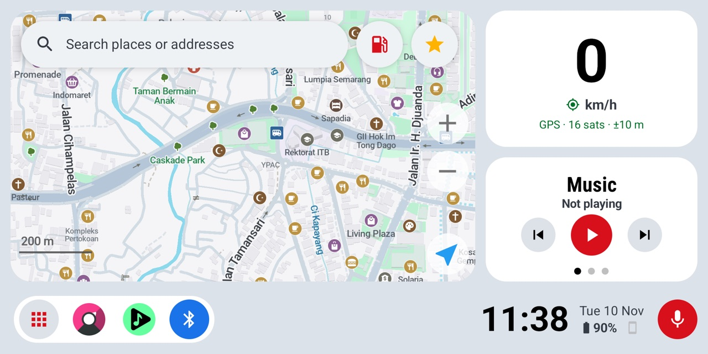
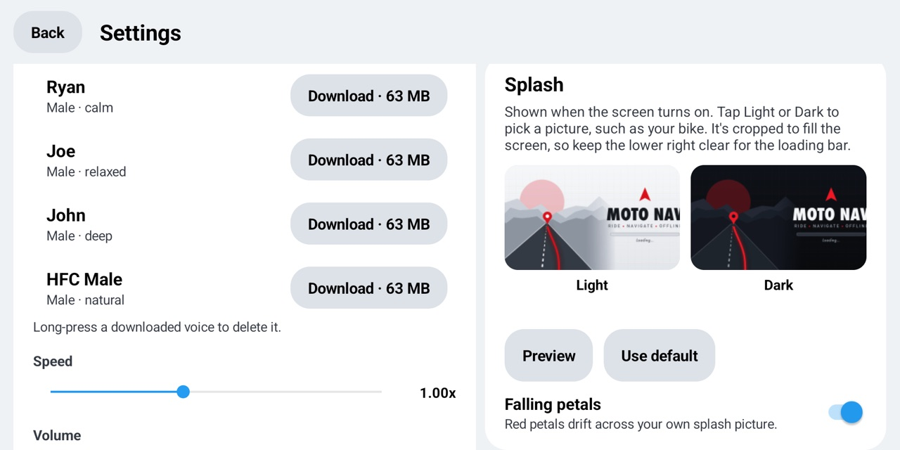

# Moto Nav user guide

[Bahasa Indonesia](USER_GUIDE.id.md)

This guide walks you through setting up Moto Nav on a spare Android phone mounted on your motorcycle, and using it on the road.

- [1. What you need](#1-what-you-need)
- [2. Install and first setup](#2-install-and-first-setup)
- [3. The home screen](#3-the-home-screen)
- [4. Navigating](#4-navigating)
- [5. Voice commands](#5-voice-commands)
- [6. Saved places](#6-saved-places)
- [7. Connecting your main phone (Chronos)](#7-connecting-your-main-phone-chronos)
- [8. Using the intercom button for voice (advanced)](#8-using-the-intercom-button-for-voice-advanced)
- [9. Dock and app drawer](#9-dock-and-app-drawer)
- [10. Trips](#10-trips)
- [11. Settings](#11-settings)
- [12. Ignition automation (root)](#12-ignition-automation-root)
- [13. Updating](#13-updating)
- [14. Troubleshooting](#14-troubleshooting)

## 1. What you need

- A spare Android phone with a 64-bit ARM processor. Android 9 or newer is recommended.
- About 3 GB of free space for maps, a guidance voice and the speech model.
- A phone mount, and USB power from the bike if you can. Moto Nav keeps the screen on while charging.
- Optional extras:
  - A Bluetooth helmet intercom, for hearing directions and giving voice commands.
  - Your main phone with the **Chronos** app, for notifications, calls and weather.
  - Root (Magisk), for ignition automation.

## 2. Install and first setup

1. Download the latest `MotoNav-vX.Y.Z-arm64.apk` from [Releases](https://github.com/edgarjuvianno/moto-nav/releases/latest) on the head unit phone and open it. Allow installing from your browser or file manager when Android asks.
2. Press the phone's Home button and choose **Moto Nav** → **Always** to make it the home screen. If Android doesn't ask, go to **Android Settings → Apps → Default apps → Home app**.
3. Open Moto Nav and allow **Location** and **Notifications** when asked.
4. Open the app drawer (grid button, bottom left) → **Settings**. The **Setup** card at the top lists what's left and has a button for each step:
   - **Home screen**, **Location** and **Microphone**: tap **Set** or **Allow**.
   - **Guidance voice**: tap **Download** to jump to the voices. Download one, such as Lessac or Amy, and tap **Use**.
   - **Voice commands model**: tap **Download** to jump to Whisper. **Base** (about 161 MB) is recommended.
   - The optional extras are music controls, the phone link (Chronos) and the intercom button. See sections 7 and 8.
5. Download the offline maps for your area: **Settings → Maps → Manage and update maps**.

If a step is still missing, Moto Nav reminds you with a banner on the home screen.

Moto Nav works fully offline. You only need internet to download maps, voices and updates, ideally over Wi-Fi.

## 3. The home screen

| Item | What it does |
| --- | --- |
| Search box | Search places and addresses. While you're riding it starts voice input instead. |
| ⛽ Fuel button | Finds the nearest gas stations. |
| ⭐ Star button | Shows your saved places and lets you save your current location. |
| Speed card | Your speed and GPS status. Tap it to open Trips. |
| Side panel | Swipe or tap the dots to switch between **Music**, **Weather** and **Notifications**. It returns to Music after 15 seconds. |
| Grid button (bottom left) | App drawer, Trips, Find phone and Settings. Locked while riding. |
| Dock icons | Your favourite apps. Long-press an icon to change the dock. |
| Clock, date and batteries | The head unit's battery, and your main phone's battery once Chronos is connected. |
| 🎤 Mic button | Voice commands. |

Moto Nav considers you riding above 15 km/h, and stopped after 20 seconds below 5 km/h. While riding, the app drawer is locked and the search box switches to voice.

**Screen on and off:** turning the screen off always brings Moto Nav back to the map, and turning it on plays the splash animation.

**Music controls:** to show what's playing, Moto Nav needs notification access. Turn it on from **Settings → Setup → Music controls**, or tap the song title once.

## 4. Navigating

1. Search for a place, tap the fuel or star button, or use a voice command. Search results, place details and saved places open in a panel on the left, next to the map.
2. Pick a result and tap **Start**. The route preview shows the time, distance and stops. Tap **+ Add stop** to stop somewhere on the way, then tap **Start**. While you're riding, navigation starts right away without the preview.
3. Turn-by-turn voice guidance starts automatically, so you don't need to tap anything else.
4. While navigating, tap **+ Add stop** at the bottom left, pick a place, check the new route and tap **Continue**.

Routes always avoid toll roads and motorways.

## 5. Voice commands

Tap the 🎤 button, or use your intercom (see [section 8](#8-using-the-intercom-button-for-voice-advanced)), then speak **in English** once the listening screen appears.

| Say | What happens |
| --- | --- |
| "navigate to Garut", "take me to Alun-Alun Bandung" | Searches the place and shows the results |
| "find a gas station", "gas station", "fuel" | Searches nearby gas stations |
| "find a hospital", "pharmacy", "parking", "mosque", "ATM" | Searches nearby places of that type |
| "take me home", "go home" | Navigates to your saved place called **home** |
| "navigate to office" | Navigates to a saved place by its nickname |
| "next song", "previous song" | Skips tracks |
| "pause music", "play music" | Pauses or resumes |
| "open Musicolet", "open apps" | Opens an app or the app drawer |

Short and clear phrases work best. Words like "nearest" and "near me" are fine. Place names that are hard to pronounce in English can be misheard, so save the places you visit often (see [section 6](#6-saved-places)) and call them by an easy nickname.

## 6. Saved places

- **Save where you are:** tap ⭐ → **Save my current location**.
- **Save a place:** tap a place on the map or in the search results, then tap **☆ Save**.
- Give each place a short nickname you can say, such as **home**, **office** or **gym**. Then say "take me home" or "navigate to office".
- **Rename or delete:** go to **Settings → Saved places**. Tap a place to rename it, or long-press it to delete it.

## 7. Connecting your main phone (Chronos)

Moto Nav acts as a smartwatch for your main phone, using the free **Chronos** app.

What you get:
- Notifications from your main phone, as a 5-second banner at the top plus a list in the Notifications panel. The list is kept until the phone disconnects.
- An **Incoming call** banner with the caller's name. Tap it to hide it. It disappears by itself when the call ends.
- Weather, with a heads-up banner when rain is expected within the hour.
- Your main phone's battery level, with a warning at 20% or below.
- **Find phone**: open the app drawer → **Find phone** to make your main phone ring until you tap **Found it**.

Setup:
1. On the head unit, turn Bluetooth on.
2. In **Settings → Setup**, tap **Allow** next to **Phone link (Chronos)** to grant the Nearby devices permission.
3. Open Moto Nav and keep it on screen.
4. On your main phone, install **Chronos** from the Play Store and add a new watch. Pick the device that has the head unit's Bluetooth name.
5. Moto Nav shows "Phone connected (Chronos)".

## 8. Using the intercom button for voice (advanced)

Most intercoms have a voice assistant or "redial" action. Moto Nav can turn **redial** into "start listening", so you can give voice commands without touching the screen.

1. In **Settings → Setup**, tap **Allow** next to **Intercom voice button**. Allow **Call logs**, then choose Moto Nav as the call redirecting app when Android asks.
2. Pair the intercom with the head unit phone.
3. Go back to the map once. Moto Nav adds a "Moto Nav voice" entry as your last dialled number.
4. On the road, use your intercom's **redial** action. For many intercoms that's a double tap on the phone button; check your intercom's manual. Instead of calling, Moto Nav starts listening.

## 9. Dock and app drawer

- **Open the drawer:** tap the grid button at the bottom left. The header has **Back**, **Trips**, **Find phone** and **Settings**.
- **Add an app to the dock:** in the drawer, long-press the app → **Add to dock**. The dock holds up to 6 apps.
- **Change the dock:** long-press a dock icon to **Replace**, **Move left**, **Move right**, **Remove**, **Add shortcut** or **Reset to default**.

## 10. Trips

Moto Nav records your rides automatically:
- A trip starts above 10 km/h and ends after 5 minutes stopped.
- Trips shorter than 300 m are skipped.

Open Trips by tapping the speed card, or from the drawer. Each trip shows its time, distance, duration, average speed and top speed. At the top you'll find totals for today, the last 7 days, this month and all time. Long-press a trip to delete it.

## 11. Settings

Open it from the drawer → **Settings**.

- **Setup:** what's left to set up, with a button for each step. It shows "Everything is set up" when you're done.
- **Voice guidance:** download, choose and delete voices. Adjust speed and volume, choose whether street names are announced, and **Test voice**.
- **Voice input:** download or delete Whisper models.
- **Saved places:** rename or delete them.
- **Theme:** **Auto** follows the light sensor; you can also force **Light** or **Dark**.
- **Splash:** tap **Light** or **Dark** to pick your own photo, such as your bike. Tap **Preview** to check it and **Use default** to go back. **Falling petals** adds drifting petals.
- **Ignition automation:** only shown when the phone has root (see below).
- **Maps:** manage and update offline maps. Maps also update automatically over Wi-Fi when you're not riding.
- **Device status:** battery, temperature, memory and storage.
- **About:** the app version and **Check for updates**.

A **heat warning** appears when the head unit's battery reaches 43 °C or the CPU 80 °C. Close it with ✕; it also clears itself once the phone cools down. Shade the phone or let it rest if you see it often.

## 12. Ignition automation (root)

If the head unit phone is rooted with Magisk, Moto Nav can follow your ignition, using the bike's USB power as the signal:
- **Ignition on (charger plugged in):** the screen wakes, location turns on and airplane mode turns off.
- **Ignition off (charger unplugged):** the screen turns off right away. After 15 seconds, location turns off and airplane mode turns on to save battery.
- **Parked for 48 hours:** the phone powers off.

To use it, turn on **Settings → Ignition automation → Follow the ignition** and grant Moto Nav superuser access in Magisk. To hide Magisk's "granted superuser" toast, open Magisk → Superuser → Moto Nav and turn off notifications.

## 13. Updating

Go to **Settings → About → Check for updates**. Moto Nav downloads the latest release from GitHub, checks it and installs it:
- With root, the update installs silently and Moto Nav restarts.
- Without root, Android asks you to confirm.

On Wi-Fi, Moto Nav also checks every few hours and shows a banner when a new version is out. Your maps, voices, saved places and splash pictures are kept.

Moto Nav is free. Only download it from this repository's [Releases](https://github.com/edgarjuvianno/moto-nav/releases). If you paid for it, you were overcharged.

## 14. Troubleshooting

| Problem | Try this |
| --- | --- |
| No voice directions | Download a voice in **Settings → Voice guidance** and tap **Use**. Check the media volume and that the intercom is connected. |
| "Download a voice input model in Settings" | Download Whisper Base in **Settings → Voice input**. |
| Voice commands misheard | Speak English, in short phrases, after the listening screen appears. Use saved places for local names. |
| GPS stuck on "searching" | Make sure location is on and the phone can see the sky. The first fix after a long time off can take a minute. |
| Weather or notifications say "Connect your phone with Chronos" | Check **Settings → Setup → Phone link (Chronos)**, then follow [section 7](#7-connecting-your-main-phone-chronos). |
| Music panel shows nothing | In **Settings → Setup**, tap **Set** next to **Music controls** and allow Moto Nav. |
| Apps button does nothing | It's locked while riding. Stop first. |
| Ignition automation missing from Settings | The phone isn't rooted, or Magisk denied Moto Nav. |
| Update check says "No published release found" | There's no release on GitHub right now. Try again later. |

Found a bug or have an idea? [Open an issue](https://github.com/edgarjuvianno/moto-nav/issues).
